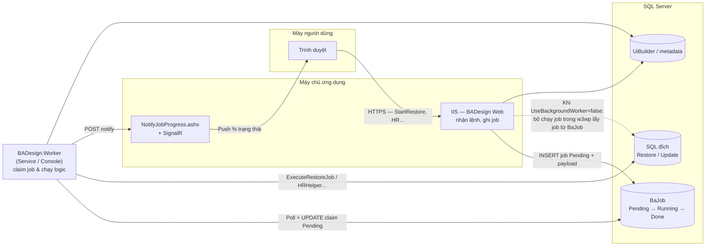

# Slide: Kiến trúc Web + Worker (BADesign)

**Tiêu đề slide:** Kiến trúc xử lý job nền — Web, BaJob & BADesign.Worker  

**Phụ đề (tùy chọn):** Restore / HR Helper — tách giao diện và tiến trình nặng  

---

## Sơ đồ (Mermaid — dán vào Notion / GitHub / Mermaid Live / plugin PowerPoint)



**Luồng chính (UseBackgroundWorker = true):**  
Browser → IIS (chỉ tạo job) → **BaJob** → **Worker** (thực thi) → **SQL đích**; Worker → **Notify** → SignalR → Browser.

---

## Sơ đồ tuyến tính (copy lên PowerPoint / Google Slides)

```
┌──────────┐    HTTPS     ┌─────────────┐    ghi/đọc    ┌──────────┐
│ Trình    │ ──────────► │ IIS         │ ◄──────────► │ BaJob    │
│ duyệt    │             │ (BADesign)  │              │ (DB app) │
└──────────┘             └──────┬──────┘              └────┬─────┘
     ▲                          │                          │
     │ SignalR / polling        │                          │ claim +
     │ tiến độ                  │                          │ chạy job
     │                          ▼                          ▼
     │                   ┌─────────────┐            ┌───────────┐
     └────────────────── │ Notify      │ ◄─ HTTP ── │ Worker    │
                         │ (ashx)      │            │ (.exe)    │
                         └─────────────┘            └─────┬─────┘
                                                          │
                                                          ▼
                                                    ┌───────────┐
                                                    │ SQL Server│
                                                    │ (đích +   │
                                                    │ restore)  │
                                                    └───────────┘
```

---

## Ghi chú trình bày (speaker notes — 3 câu)

1. **IIS** chỉ nhận lệnh và **ghi hàng đợi** `BaJob`; user không bị giữ request restore lâu trên một kết nối HTTP.
2. **Worker** là process riêng: **lấy job Pending**, chạy **cùng logic** với web (`ExecuteRestoreJob`, HR…) nhưng **ngoài w3wp**, có giới hạn song song và xếp hàng theo server/database.
3. **Cập nhật %**: Worker cập nhật DB + (tùy cấu hình) gọi **Notify** để **SignalR** đẩy về trình duyệt.

---

## Chế độ so sánh (1 dòng trên slide)

| `UseBackgroundWorker = true` | `UseBackgroundWorker = false` |
|------------------------------|-------------------------------|
| Job **Pending** → **Worker** chạy | Job **Pending** → **bộ chạy job trong IIS** chạy (cùng hàng đợi, cùng giới hạn như Worker) |

---

*Tệp này dùng cho giới thiệu sản phẩm; có thể xuất PDF từ Markdown hoặc vẽ lại sơ đồ trong PowerPoint cho đẹp hơn.*
