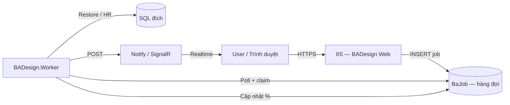

# Điều chỉnh 4 slide — Internal Release (UI Builder & HR Helper Web)

Tài liệu này chỉnh **nội dung + thuật ngữ** cho khớp sản phẩm thật (BADesign: Web + `BaJob` + `BADesign.Worker` + SignalR). Bạn copy từng phần vào PowerPoint / Google Slides.

---

## Thay đổi chung (áp dụng cả 4 slide)

| Vấn đề | Đề xuất |
|--------|---------|
| Slide 1 chỉ nhấn **HR Helper** | Thống nhất **“UI Builder & HR Helper”** (đã có ở footer slide khác) — HR Helper là module chính của đợt release, nền tảng là **một URL / nhiều module**. |
| Sơ đồ ghi **“BaJob (Worker Service)”** | **Sai tên hợp nhất:** **BaJob** = bảng hàng đợi job trong DB; **BADesign.Worker** = Windows Service / console **claim** job và **chạy** restore/HR. Trên slide nên tách 2 khái niệm. |
| Đánh số lệch (tiêu đề “03” vs footer “04”) | **Một quy ước:** số footer = thứ tự slide; tiêu đề mục lục **trùng** (vd. Slide 4 → footer **04**, dòng mục **“03 • …”** đổi thành **“04 • …”** hoặc bỏ số mục, chỉ giữ tiêu đề). |
| “Chạy nền bằng worker” | Giữ, nhưng thêm **một chữ** cho rõ: *“job nặng chạy trên **Windows Worker** (process riêng), không nằm trong phiên IIS của user”* — tránh hiểu nhầm “worker chỉ phân phối”. |

---

## Slide 1 — Bìa / Tổng quan  
*(Ảnh: Window → Web, 3 thẻ Nhanh / An toàn / Thuận tiện)*

### Tiêu đề (giữ hoặc chỉnh nhẹ)
**UI Builder & HR Helper — Web**  
*RELEASE NỘI BỘ 2026*

### Phụ đề
**Từ tool Windows lên nền tảng Web nội bộ** — một URL, một phiên bản cho cả team.

### Mô tả ngắn (thay thế đoạn cũ nếu cần)
Nền tảng web nội bộ tập trung **Database Search**, **HR Helper**, **UI Builder**, **mã hóa / PGP**, **cấu hình & phân quyền** — giúp thao tác **nhanh hơn**, **chuẩn hóa quy trình** và **an toàn hơn** cho BA / CONS / DEV / QC và Super Admin.

### Ba thẻ — chỉnh bullet cho khớp thực tế

1. **Nhanh hơn**  
   Kết nối DB, **backup / restore**, tùy chọn **reset** sau restore, và các thao tác HR — **một luồng trên web**, không phải nhảy nhiều tool.

2. **An toàn hơn**  
   **Role / phân quyền**, **Audit Log**, **Function Queue**, **thông báo realtime** (chuông + tiến độ job).

3. **Thuận tiện hơn**  
   **App Settings** dùng chung (email, SFTP, cấu hình reset), mọi người **cùng version** khi truy cập qua URL.

### Focus release (bullet cuối — siết lại)
- Chuẩn hóa **Restore + Reset** trong một luồng.  
- Đồng bộ phiên bản cho toàn team (deploy tập trung).  
- **Theo dõi job realtime:** Notification + Function Queue; **job nặng** có thể chạy bởi **BADesign.Worker** (tùy cấu hình server).

---

## Slide 2 — 01 • NGUỒN GỐC PHÁT TRIỂN  
*(4 ô pain → HR Helper)*

### Giữ nguyên ý chính; chỉnh 1 dòng kết nối web (tùy chọn)
Ô 4 **“Từ một nhu cầu nhỏ…”** — có thể thêm:  
*“Hiện mở rộng thành **nền tảng web** để nhiều vai trò cùng dùng, có audit và hàng đợi job.”*

### Caption ảnh
**HR Helper** — thao tác trực tiếp trên **User / Employee / Company** (phiên bản web; trước đây tương đương trên Windows).

### Footer
**UI Builder & HR Helper**

---

## Slide 3 — 02 • LÝ DO NÂNG CẤP  
*(Window: vấn đề | Web: ảnh giải pháp)*

### Tiêu đề — giữ
**Vì phiên bản Windows không còn đủ cho quy mô sử dụng hiện tại**

### Intro — siết một câu (tùy chọn)
Vấn đề cốt lõi: **version rời rạc**, **quy trình tách bạch** (restore xong phải nhớ reset), và **trải nghiệm kém** khi dữ liệu lớn — web tập trung hóa và **tách job nặng** khỏi máy người dùng (qua server + worker).

### Cột Windows — giữ 4 ý; tag dưới cùng giữ (Version lệch / Quy trình rời / Tốn thời gian)

### Cột Web — caption ảnh (giữ + bổ sung nhẹ)
- **Restore + chọn file backup trên web**  
- **Tích hợp tùy chọn Reset** trong cùng luồng  
- **Thông báo realtime** + **Function Queue** (theo dõi %, trạng thái job)

### Footer
**UI Builder & HR Helper**

---

## Slide 4 — Giới thiệu sản phẩm mới + kiến trúc  
*(Sửa số slide + sơ đồ)*

### Đánh số
- **Footer:** `04` (hoặc đúng thứ tự deck của bạn).  
- **Dòng mục:** đổi **“03 • …”** → **“04 • GIỚI THIỆU SẢN PHẨM MỚI”** để **không lệch** với footer; hoặc bỏ số “03”, chỉ để tiêu đề.

### Tiêu đề
**UI Builder & HR Helper trên nền Web**

### Phụ đề (bản chỉnh — chính xác kỹ thuật hơn)
**Một URL — một version mới nhất cho tất cả.** Tích hợp thao tác chính; **IIS** nhận lệnh và ghi **hàng đợi `BaJob`**; **BADesign.Worker** (service riêng) **lấy job và chạy** restore/HR; cập nhật tiến độ qua DB và **SignalR / Notify** về trình duyệt.

### Cột trái — 3 ô (giữ cấu trúc, chỉnh chữ nhỏ nếu muốn)

| Ô | Nội dung gợi ý |
|---|----------------|
| **Database Search** | Quét server, backup, restore, shrink log, reset hàng loạt; mở **HR Helper** từ DB đích. |
| **HR Helper** | User / Employee / Company; reset email/phone; chữ ký; Multi-DB. |
| **Kiểm soát & theo dõi** | App Settings, Role, Audit Log, **Notification**, **Function Queue**, Feedback. |

### Sơ đồ kiến trúc — **nhãn đề xuất** (thay cho “BaJob = Worker Service”)

Dùng **6 ô** và mũi tên rõ ràng:

1. **User / Trình duyệt**  
2. **IIS — Web App (BADesign)**  
3. **SQL — bảng `BaJob` (hàng đợi + trạng thái)**  
4. **BADesign.Worker** (Windows Service / console)  
5. **SQL đích** (restore / cập nhật dữ liệu)  
6. **SignalR / Notify** (đẩy % về client)

**Luồng gợi ý ghi trên mũi tên:**  
User → IIS (**HTTPS, tạo job**) → **BaJob** (Pending) → Worker (**claim + chạy**) → SQL đích  
Worker → cập nhật **BaJob** → **Notify** → SignalR → User  

*(Không gộp chữ “BaJob” và “Worker Service” vào một ô.)*

### Caption ảnh UI (giữ ý)
- **Trên:** Restore + Reset tích hợp; theo dõi qua **Function Queue / Notification**.  
- **Dưới:** UI Builder, Encrypt/Decrypt, PGP, module vận hành nội bộ.

### Ghi chú trình bày (15 giây)
*“Khi bật **UseBackgroundWorker**, web không chạy restore dài trong request — Worker process chạy cùng logic trong code nhưng tách khỏi IIS; khi tắt, job chạy bằng **bộ chạy job ngay trong app pool**, cùng hàng đợi và giới hạn như Worker.”*  
(Chỉ nói nếu audience kỹ thuật.)

---

## Mermaid (nếu vẽ lại sơ đồ slide 4)

`linkStyle` tùy chọn theo slide trước của bạn.

---

## Checklist trước khi present

- [ ] Tên sản phẩm thống nhất: **UI Builder & HR Helper** (slide 1 không chỉ “HR Helper” nếu deck là cả nền tảng).  
- [ ] Sơ đồ: tách **BaJob** và **BADesign.Worker**.  
- [ ] Số slide footer = số mục lục (hoặc bỏ số mục).  
- [ ] Nếu server chưa cài Worker: nói *“tùy cấu hình”* hoặc *“đang rollout”* cho câu về Worker.

---

*Tệp bổ sung: `Architecture-Slide-Web-Worker.md` — chi tiết luồng Browser → IIS → BaJob → Worker → SQL / Notify.*
